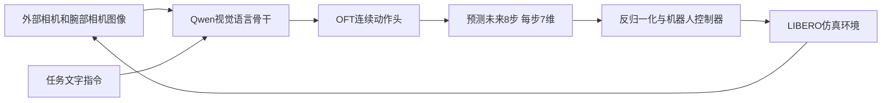

# StarVLA项目原理与学习路线

整理日期：2026-11-19。基于当前交付代码及当日读取的项目官方仓库、论文和文档。当前64卡StarVLA训练尚无用户回传的实际运行结果；π0.5六回合成功为用户报告的独立推理诊断。

项目定位：基于StarVLA的VLA监督训练、昇腾多节点适配、完整断点恢复和LIBERO闭环评测。预训练VLM＋动作预测、监督微调、闭环评估仍是常见技术路线；Qwen2.5-VL-3B＋OFT属于有依据、易分析的基线，不应宣称2026年11月最前沿模型或行业唯一主流。

## 名称与职责

| 名称 | 当前项目中的职责 |
|---|---|
| Qwen2.5-VL-3B-Instruct | 已具备视觉语言能力的预训练基座，约3B量级 |
| StarVLA | 数据、模型、训练和评测框架 |
| QwenOFT | 选择的模型结构：Qwen视觉语言特征＋连续动作MLP |
| LIBERO Spatial | 10个空间关系操控任务及对应示范、初态、成功判定 |
| MuJoCo/robosuite | 仿真物理和机器人控制环境 |
| ModelArts/910B | 训练任务调度、计算设备及分布式通信环境 |
| OBS | 作业结束后保留数据、权重、断点、日志 |

当前模型从通用Qwen VLM权重初始化，动作头新初始化。它不继承π0.5的机器人动作能力，也没有加载StarVLA已经训练好的4in1 VLA权重。训练会更新视觉语言骨干及动作头；当前是全参数监督学习，不是LoRA，也尚未做RL。

## 一个推理周期

当前直接输入两张RGB图像与文字，不额外输入关节/末端本体状态，不使用长时视频记忆。视频是离线示范的存储形式，训练时按时间戳抽取当前图像。当前图像读取为224×224，之后还经过Qwen processor处理。

7维动作为末端平移增量3维、姿态增量3维和夹爪控制1维。实际单位、缩放、旋转表示与正负号由数据和环境控制器共同决定；不能因字段叫roll/pitch/yaw或配置叫delta_qpos就认定是直接控制七个关节角。当前配置中的这类名字必须结合实际接口解释。

OFT从图像和指令构造的序列中提取动作查询位置的隐藏特征，通过MLP一次得到8×7连续数值。它不是先生成中文计划、再调用运动规划器；当前也没有额外CoT监督。一次预测8步不要求一次全部执行，可以执行前K步后重新观察，K不超过预测长度。

## 监督训练的基础

训练样本包括当前两张图、指令和示范轨迹中对应的未来8步动作。动作标签是专家示范，模型输出是预测动作；L1损失衡量二者在归一化动作空间中的绝对偏差：

`L = mean(abs(predicted_actions - demonstration_actions))`

前向计算得到预测和损失，反向传播计算梯度，AdamW使用梯度及其历史统计更新参数。学习率决定更新幅度；预训练骨干使用较小学习率，新动作头使用较大学习率。训练初期warmup逐步增加学习率，随后按调度衰减。

这是行为克隆（Behavior Cloning），也是广义监督微调SFT。VLA并非只能用RL训练。当前SFT读取离线数据，不需要每一步启动MuJoCo让机器人尝试；RL阶段才会大量涉及环境交互、奖励、rollout和策略更新。

动作归一化把量纲与范围不同的控制量映射到便于优化的数值范围。训练和推理必须使用匹配的统计值，执行前反归一化。双相机顺序、图像旋转、姿态坐标、夹爪符号或动作统计不匹配，都可能造成“能动但总对不准”。

432条示范包含52,970帧。采样以当前帧为锚点形成未来动作窗口；同一轨迹相邻窗口高度相关。64卡×每卡batch1×累积1=全局batch64；1000次优化更新约消费64,000个样本。当前mixture有随机重复采样，因此64,000/52,970约1.2仅表示样本量比例，不能认定每条数据都恰好完整看过1.2遍。

## 闭环控制和失败恢复

预测时看到的场景会因动作而改变。连续执行过长的动作段可能让抓取偏差持续扩大；重新获取图像并预测动作可以纠正部分偏差。这称为闭环或滚动时域执行。

此前π0.5诊断把执行段从50步缩短为10步。按20Hz环境控制频率，相当于从2.5秒仿真动作后重规划改为0.5秒。用户回报对应六回合全部成功；若为预定的task1/task4相同初态，则该子集从3/6到6/6。此结果支持更频繁视觉反馈的假设，尚不能替代全任务与新初态评估。

这次改善没有更新模型权重，属于推理执行策略调整。推理调用次数也可能增加，速度、算力与反应能力存在取舍。服务器逐步仿真可以等待模型，仿真成功不等于真实机器人达到20Hz控制；之前约0.75秒的单次推理延迟也不能忽略。

行为克隆还会遇到分布偏移：训练中多为成功抓取，部署时模型一旦把物体碰歪，后续状态可能超出示范覆盖。更多正常成功示范未必能解决这种问题。恢复示范、DAgger式数据聚合、环境扰动训练或RL各有用途，需要根据失败原因选择。

## 64卡和断点恢复

8个节点各8个训练进程。每张卡处理不同样本并计算梯度，通信把这些贡献合成同一个模型的更新。增加卡数不直接增加知识或成功率；同全局batch下主要改变并行方式、吞吐和通信开销。

ZeRO2切分优化器状态和梯度，模型参数仍在每卡保留完整副本。BF16降低计算与参数存储成本，关键优化器状态使用FP32。激活检查点通过反向时重算部分前向结果换取更低激活显存；HCCL负责昇腾设备通信；Accelerate组织启动与训练状态，DeepSpeed实现ZeRO优化。

64卡对目前3B＋Spatial小数据任务并非必要，也未必最经济。它适合验证用户已有资源上的多节点能力，是否值得长期用64卡需测每秒样本数、NPU利用率、每步时间、CPU读视频耗时、通信耗时和保存时间。

当前实现第1步和之后每100步保存完整state。每个节点上传自己的优化器分片和随机状态，节点0还提供模型state；所有8节点完成后更新全局_COMPLETE与LATEST。只保存权重可用于推理或重新微调，完整训练恢复还需要优化器、调度器、步数、随机状态和数据位置。恢复要求相同64卡拓扑、代码和训练配置。

CPU恢复及模拟OBS故障测试已通过，真实64卡HCCL、NPU算子与OBS链路仍待作业验证。此前2–4小时是首轮1000步的排期假设，不是收敛时长或已测性能。

## 这条路线的当前地位

StarVLA技术报告首次提交2026-04-06，OFT原始工作为2025-02。它们都不应被包装成截至2026-11-19“最近半年刚提出”的算法。当前官方StarVLA已支持Qwen3/3.5、流匹配动作头、世界模型骨干和RLinf接入；保留Qwen2.5＋OFT是为了建立可检查的基线，不是因为它最新。

| 路线 | 思路 | 价值与限制 |
|---|---|---|
| OFT连续回归 | 一次预测一段连续动作，直接拟合示范 | 推理路径简单、容易分析；复杂多峰动作分布的表达受限 |
| 自回归动作token/FAST | 将动作编码成token序列再预测 | 可接语言模型序列建模工具；解码速度受token化与序列长度影响 |
| Diffusion/Flow Matching动作专家 | 条件于视觉语言特征，将噪声逐步转为动作 | 更灵活地表示动作分布；推理步数、采样和部署更复杂 |
| RL后训练 | 从实际交互结果优化奖励 | 可改进任务完成与恢复；需要稳定策略、奖励、探索和大量rollout |

后三者不是按时间必然取代前者。动作头结构与SFT/RL训练方式是不同维度；流匹配也常用示范监督训练。L1方法在一些任务中仍有强表现，但不能据某个LIBERO分数推断其普遍强于流匹配。

官方NVIDIA GR00T仓库当前介绍N1.7及其流匹配动作头，openpi公开π0/π0.5流匹配模型，说明这类动作专家是重要发展方向。RLinf官方文档仍提供QwenOFT＋LIBERO Spatial的GRPO示例并注明华为Ascend CANN支持，说明OFT路线仍有后续实验路径。但我们当前交付的SFT包没有自动接好该RL流程，也不能声称任意checkpoint无需适配即可直接互换。

## 如何证明项目有价值

上游StarVLA示例报告四个LIBERO套件联合训练约30,000步，每套件10任务×50回合评测。当前仅Spatial＋1000步，与其数据量、预算和协议不同，不能宣称复现了官方分数。1000步可以作为训练工程和初始学习检查；真正的模型效果仍需足够训练预算和闭环评测。

有用的交付包括：可重复的数据清单与归一化统计；昇腾训练启动和性能记录；中断前后真实恢复证据；固定初态的每任务成功率、超时、错误和视频；一项可归因的改进与未参与调参的验证集。

算法后训练方向应补充行为克隆限制、失败数据构建、奖励/优势、PPO/GRPO原理、SFT与RL对照。训练部署方向应补充数据吞吐、算子兼容、HCCL、ZeRO、显存分析、checkpoint一致性和推理延迟。两周内优先完成一个证据完整的主线实验，避免同时换模型、数据、动作头和评测协议。

学习优先级：张量形状/前反向/梯度/优化器→VLM编码与动作表示→数据对齐/归一化/行为克隆→闭环执行与泛化评测→多卡通信与恢复→RL与流匹配。每个概念结合当前代码和失败视频理解。

## 主要来源

- StarVLA技术报告：https://arxiv.org/abs/2604.05014
- StarVLA官方仓库：https://github.com/starVLA/starVLA
- 固定版本LIBERO训练与评测：https://github.com/starVLA/starVLA/blob/261ba5dd4313bbb910a9caeea07433c3d7b1aa34/examples/LIBERO/README.md
- OFT原始项目：https://openvla-oft.github.io/
- OFT论文：https://arxiv.org/abs/2502.19645
- LIBERO官方：https://github.com/Lifelong-Robot-Learning/LIBERO
- Physical Intelligence openpi：https://github.com/Physical-Intelligence/openpi
- NVIDIA Isaac GR00T：https://github.com/NVIDIA/Isaac-GR00T
- RLinf StarVLA教程：https://rlinf.readthedocs.io/en/latest/rst_source/examples/embodied/starvla.html

原始页面快照位于 `engineering/results/project-explanation-sources/`。对具体企业内部技术占比没有调查，本文的“常见/重要方向”依据公开模型与实现，不是市场份额结论。
